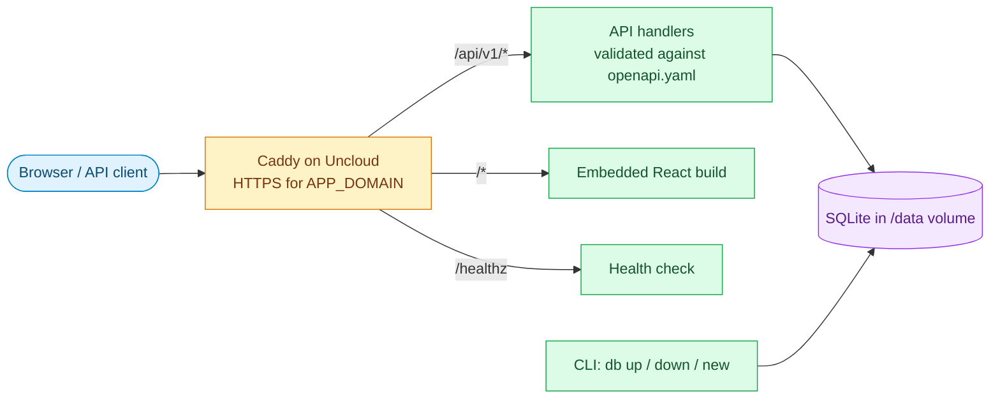

# golang-app-template

A starting point for a Go web app that ships as one binary. The binary serves a
JSON API, the React UI compiled into it, and a CLI. It deploys to an
[Uncloud](https://github.com/psviderski/uncloud) cluster as a single container.

| Part | Built with |
|---|---|
| **API** | chi v5, OpenAPI 3 spec with oapi-codegen (strict server), request validation, RFC 9457 problem+json errors |
| **CLI** | urfave/cli v3: `serve`, `db`, `health` |
| **Database** | SQLite (modernc.org/sqlite, no CGO), goose migrations, sqlc queries |
| **UI** | React 19, Vite 8, Tailwind 4, shadcn, Biome 2 |
| **Delivery** | Distroless Docker image, GitHub Actions CI, Uncloud deploy |
| **Agent skills** | APM-managed skills for Claude Code, including skills to rename the app and switch to PostgreSQL |

## Architecture



Caddy terminates TLS and forwards every request to the one container. The
server sends `/api/*` to the API router. Unknown API paths get a problem+json
404, so the UI's catch-all route never answers for the API. Every other path
serves the UI from files embedded in the binary. In development, `serve`
proxies those paths to the Vite dev server instead.

## Prerequisites

| Tool | Version | Used for |
|---|---|---|
| **Go** | 1.27.1 (`go.mod`) | Server and CLI |
| **Node** | 24 | UI build |
| **pnpm** | 11.10.0 | UI dependencies |
| **just** | any recent | Task runner (`justfile`) |
| **golangci-lint** | 2.15.0 or newer | `just lint`; older versions can't read the config |
| **sqlc** | any v2 | `just sqlc` |
| **uv** (`uvx`) | any recent | `just install-skills` |
| **Docker** | any recent | Image builds |
| **uc** | 0.20.0 | Deploys; must match the cluster daemons |

`just dev` installs [air](https://github.com/air-verse/air) on first run.

## Quick start

```bash
pnpm --dir ui install
just install-skills   # agent skills for Claude Code, optional
just dev              # API and UI on http://127.0.0.1:8080, both reloading on change
```

`just dev` runs `serve` with `--docs`, so the API reference is at
`http://127.0.0.1:8080/api/docs/` (Scalar) and `/api/docs/swagger/` (Swagger UI).

## Make it your own

The template is named `nisaba`. Rename it before writing features, so the module
path, binary, image and volume names are right from the first commit. With
Claude Code and the skills installed, ask:

> rename the app to ledger, module path github.com/acme-co/ledger

The `rename-app` skill renames every occurrence, regenerates the API code and
checks the build. The same skill handles an app that is already deployed: it
keeps the existing data volume, so the data is not lost.

To use PostgreSQL instead of SQLite, ask for that. The `migrate-to-postgres`
skill switches the driver, the migrations, tests, CI and the deploy.

## Commands

`just --list` prints every recipe.

| Recipe | What it does |
|---|---|
| `just dev` | Runs the API and UI on :8080 with live reload |
| `just test` | Runs the Go tests |
| `just testc` | Runs the Go tests and prints coverage per function |
| `just lint` | Runs golangci-lint; extra words are flags, e.g. `just lint --fix` |
| `just ui-lint` | Runs Biome on the UI; `just ui-lint --write` fixes formatting |
| `just generate` | Regenerates `api/api.gen.go` from `api/openapi.yaml` |
| `just sqlc` | Regenerates query code from `internal/db/migrations` and `internal/db/queries` |
| `just cmd <args>` | Runs the CLI with `go run`, e.g. `just cmd db new create_notes` |
| `just build` | Builds the UI, then `bin/nisaba` with the commit stamped into `--version` |
| `just deploy` | Builds the image and deploys it with `uc deploy`; needs `APP_DOMAIN` |
| `just vendor-docs` | Downloads the Swagger UI and Scalar versions pinned in `internal/web/assets/docs/VERSIONS` |
| `just install-skills` | Installs the agent skills listed in `apm.yml` into `.claude/skills` |

Run `just test`, `just lint` and `just ui-lint` before you push; CI runs the
same checks.

## Configuration

Flags win over environment variables.

| Variable | Flag | Purpose | Default |
|---|---|---|---|
| `APP_DB` | `--db` | SQLite database file | `nisaba.db` (`/data/nisaba.db` in the image) |
| `APP_DB_MIGRATE` | `serve --db-migrate` | Apply pending migrations before serving | off (on in the image) |
| `APP_DOCS` | `serve --docs` | Serve `/api/v1/openapi.json` and the docs pages | off |
| `APP_FRONTEND_DEV_SERVER` | `serve --frontend-dev-server` | Proxy the UI to Vite at this URL | unset (serve the embedded build) |
| — | `serve --address`, `--port` | Listen address | `127.0.0.1:8080` |
| — | `--log-format`, `--log-level` | `text` or `json`; `debug` to `error` | `text`, `info` |

`serve` refuses an empty `--address`. Pass `0.0.0.0` to listen on every
interface, as the image does.

## Adding an endpoint

The spec comes first:

1. Add the operation to `api/openapi.yaml`, with error responses pointing at
   `#/components/responses/Error`.
2. Run `just generate`. Never edit `api/api.gen.go`; CI fails if it doesn't
   match the spec.
3. Implement the generated method on `handlers.API` in
   `internal/web/handlers/<resource>.go`.

The OpenAPI middleware validates requests before they reach a handler. The full
set of conventions (errors, CLI flags, migrations, tests, logging) lives in the
`this-project` skill at `.apm/skills/this-project/`.

## Project layout

| Path | Contents |
|---|---|
| `cmd/nisaba/` | `main`: global flags and the list of commands |
| `internal/commands/` | One package per CLI command |
| `internal/web/` | Server, middleware, routes, error mapping; `handlers/` and `respond/` |
| `internal/db/` | Connection, embedded migrations, sqlc queries |
| `api/` | `openapi.yaml` and the code generated from it |
| `ui/` | React sources, built into `internal/web/assets/app` |
| `scripts/` | Shell helpers the justfile and CI call |
| `.apm/skills/` | This project's own agent skills |

## Deploy

`compose.yml` is the Uncloud service spec. It publishes `APP_DOMAIN` over
HTTPS and keeps the database in the `nisaba-data` volume. The container runs
`serve --db-migrate` as a nonroot user on a read-only root filesystem, and its
health check calls `nisaba health`.

To deploy from your machine, set `APP_DOMAIN` and run `just deploy`.

CI builds and tests every push. It also deploys the default branch once these
are set on the GitHub repository:

| Name | Kind | Purpose |
|---|---|---|
| `UNCLOUD_CONNECT` | Variable | Cluster address for `uc`; deploys stay off while unset |
| `APP_DOMAIN` | Variable | Public hostname |
| `UNCLOUD_KNOWN_HOSTS` | Variable | SSH host keys of the cluster machine |
| `UNCLOUD_SSH_KEY` | Secret | SSH private key for the cluster |

## Agent skills

`apm.yml` lists the skills, and `apm.lock.yaml` pins them to exact commits.
`just install-skills` installs them into `.claude/skills`. After you edit a
skill in `.apm/skills/`, run it again and commit the updated lock.

| Skill | Use it for |
|---|---|
| **this-project** | Layout and rules for any code change here |
| **go-components** | Cache, file uploads, rate limiting, auth, teams, AI agents |
| **rename-app** | Giving the template its real name |
| **migrate-to-postgres** | Replacing SQLite with PostgreSQL |

The project's own skills ship test cases in `evals/evals.json`.

### See also

- `AGENTS.md`: the short brief AI agents read first.
- `.apm/skills/this-project/references/`: detailed rules for HTTP, CLI, database, testing and delivery.
